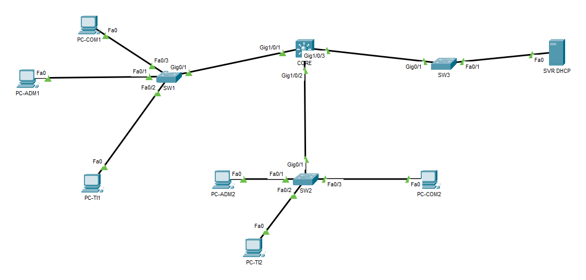
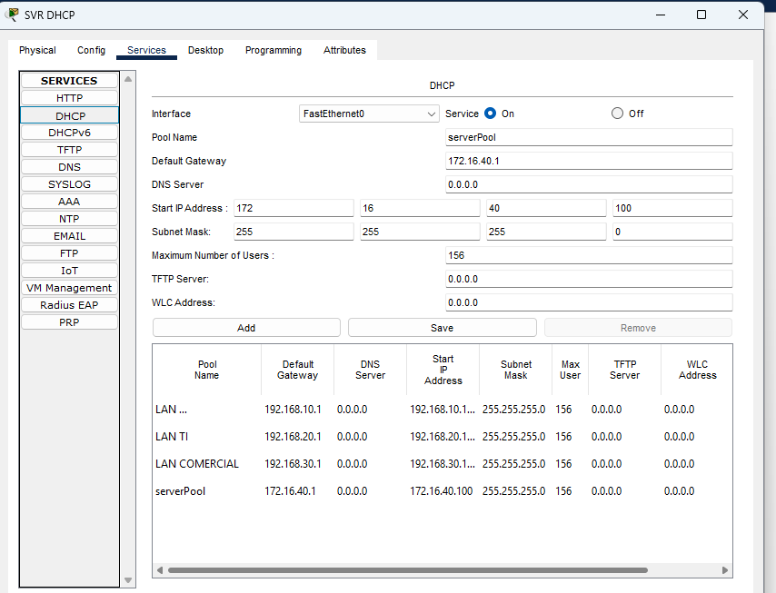
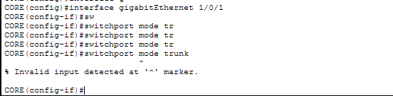

# Projeto 01: Infraestrutura de rede corporativa

Laboratório de rede corporativa no Cisco Packet Tracer, com segmentação por VLANs, roteamento entre VLANs em switch multicamada e DHCP centralizado.

**Status:** versão 1 concluída · **Simulador:** Cisco Packet Tracer 9.0.1 · **Atualizado em:** outubro de 2026



## Destaques

- Quatro VLANs, uma por setor, cada uma com sua própria rede IP
- Roteamento entre VLANs no switch multicamada, com as SVIs no CORE
- DHCP centralizado, com relay (`ip helper-address`) para as redes dos usuários
- Trunks 802.1Q entre o CORE e os switches de acesso
- Três problemas reais documentados, do sintoma à solução

## 1. Objetivo

Projetar, configurar, testar e documentar uma rede empresarial segmentada em quatro redes IP, com um switch multicamada no núcleo (CORE) e três switches de acesso.

## 2. Cenário e requisitos

Empresa fictícia com quatro setores: Administrativo, TI, Comercial e Servidores.

Requisitos:

- Separar o tráfego de cada setor em uma VLAN e uma rede IP próprias.
- Permitir a comunicação entre os setores por meio de roteamento no CORE.
- Distribuir endereços IP automaticamente para os computadores, a partir de um único servidor DHCP instalado na rede de servidores.
- Ligar os switches de acesso ao CORE por trunks 802.1Q.

## 3. Equipamentos e softwares

| Equipamento | Modelo | Sistema | Função |
|---|---|---|---|
| CORE | Cisco Catalyst 3650-24PS | IOS XE 16.3.2 | Gateways das VLANs, roteamento entre VLANs e relay DHCP |
| SW1, SW2 e SW3 | Cisco Catalyst 2960-24TT | IOS 15.0 | Switches de acesso |
| SVR DHCP | Server-PT | Packet Tracer | Servidor DHCP |
| PC-ADM1, PC-TI1, PC-COM1, PC-ADM2, PC-TI2 e PC-COM2 | PC-PT | Packet Tracer | Computadores dos usuários |

Simulador: Cisco Packet Tracer 9.0.1.

## 4. Topologia

Arquitetura em duas camadas (núcleo colapsado): o CORE concentra as funções de núcleo e distribuição, com os gateways e o roteamento entre VLANs, e SW1, SW2 e SW3 formam a camada de acesso, ligados ao CORE em estrela.

| Equipamento | Porta | Conectado a | Porta | Modo |
|---|---|---|---|---|
| CORE | Gi1/0/1 | SW1 | Gi0/1 | Trunk 802.1Q |
| CORE | Gi1/0/2 | SW2 | Gi0/1 | Trunk 802.1Q |
| CORE | Gi1/0/3 | SW3 | Gi0/1 | Trunk 802.1Q |
| SW1 | Fa0/1 | PC-ADM1 | Fa0 | Access, VLAN 10 |
| SW1 | Fa0/2 | PC-TI1 | Fa0 | Access, VLAN 20 |
| SW1 | Fa0/3 | PC-COM1 | Fa0 | Access, VLAN 30 |
| SW2 | Fa0/1 | PC-ADM2 | Fa0 | Access, VLAN 10 |
| SW2 | Fa0/2 | PC-TI2 | Fa0 | Access, VLAN 20 |
| SW2 | Fa0/3 | PC-COM2 | Fa0 | Access, VLAN 30 |
| SW3 | Fa0/1 | SVR DHCP | Fa0 | Access, VLAN 40 |

## 5. Plano de endereçamento

| VLAN | Nome | Rede | Gateway (SVI no CORE) | Endereçamento dos hosts |
|---|---|---|---|---|
| 10 | ADMINISTRATIVO | 192.168.10.0/24 | 192.168.10.1 | DHCP, pool a partir de .100 |
| 20 | TI | 192.168.20.0/24 | 192.168.20.1 | DHCP, pool a partir de .100 |
| 30 | COMERCIAL | 192.168.30.0/24 | 192.168.30.1 | DHCP, pool a partir de .100 |
| 40 | SERVIDORES | 172.16.40.0/24 | 172.16.40.1 | IP fixo (servidor: 172.16.40.2) |

## 6. Implementação

As configurações completas de cada equipamento estão na pasta [configs](configs/). Os trechos abaixo mostram o essencial.

### 6.1 VLANs

Criadas em todos os switches (CORE, SW1, SW2 e SW3):

```
vlan 10
 name ADMINISTRATIVO
vlan 20
 name TI
vlan 30
 name COMERCIAL
vlan 40
 name SERVIDORES
```

### 6.2 Portas de acesso e trunks

SW1 e SW2 têm a mesma configuração. No SW3, a Fa0/1 fica na VLAN 40, para o servidor, e a Gi0/1 é o trunk com o CORE.

```
! SW1 e SW2
interface FastEthernet0/1
 switchport access vlan 10
 switchport mode access
interface FastEthernet0/2
 switchport access vlan 20
 switchport mode access
interface FastEthernet0/3
 switchport access vlan 30
 switchport mode access
interface GigabitEthernet0/1
 switchport mode trunk
```

```
! CORE
interface GigabitEthernet1/0/1
 switchport mode trunk
interface GigabitEthernet1/0/2
 switchport mode trunk
interface GigabitEthernet1/0/3
 switchport mode trunk
```

No 3650 do Packet Tracer, a porta precisou receber o comando `switchport` antes do `switchport mode trunk` (ver [Problema 1](#problema-1-trunk-recusado-no-core)).

### 6.3 Gateways e roteamento entre VLANs

No CORE, cada VLAN tem uma interface virtual (SVI) com o IP do gateway, e o `ip routing` habilita o roteamento entre elas:

```
ip routing
!
interface Vlan10
 ip address 192.168.10.1 255.255.255.0
 ip helper-address 172.16.40.2
!
interface Vlan20
 ip address 192.168.20.1 255.255.255.0
 ip helper-address 172.16.40.2
!
interface Vlan30
 ip address 192.168.30.1 255.255.255.0
 ip helper-address 172.16.40.2
!
interface Vlan40
 ip address 172.16.40.1 255.255.255.0
```

### 6.4 DHCP centralizado com relay

Servidor com IP fixo 172.16.40.2/24, gateway 172.16.40.1 e serviço DHCP ativo na FastEthernet0. Nesta versão não há servidor DNS, por isso os pools não informam DNS.

| Pool | Rede | Gateway | Primeiro endereço | Máximo de clientes |
|---|---|---|---|---|
| LAN ADMINISTRATIVO | 192.168.10.0/24 | 192.168.10.1 | 192.168.10.100 | 156 |
| LAN TI | 192.168.20.0/24 | 192.168.20.1 | 192.168.20.100 | 156 |
| LAN COMERCIAL | 192.168.30.0/24 | 192.168.30.1 | 192.168.30.100 | 156 |
| serverPool | 172.16.40.0/24 | 172.16.40.1 | 172.16.40.100 | 156 |

O `serverPool` é o pool padrão do Packet Tracer para a rede do próprio servidor. Como a VLAN 40 não tem clientes DHCP, ele fica sem uso.



**Como o relay funciona.** O pedido DHCP do PC é um broadcast e não sai da VLAN. A SVI da VLAN no CORE recebe o pedido e, por causa do `ip helper-address`, encaminha ao servidor 172.16.40.2 em unicast, informando o próprio IP como endereço de origem do relay. O servidor usa esse endereço para escolher o pool da rede certa.

## 7. Testes e resultados

Os testes de conectividade foram feitos primeiro com IPs fixos (27/10/2026) e repetidos com os endereços recebidos por DHCP (28/10/2026), que são os registrados abaixo.

| # | Teste | Comando | Resultado |
|---|---|---|---|
| 1 | VLANs no CORE | `show vlan brief` | VLANs 10, 20, 30 e 40 ativas, com os nomes dos setores |
| 2 | Trunks entre o CORE e os switches | `show interfaces trunk` | Gi1/0/1 a Gi1/0/3 em trunking 802.1Q, com as VLANs 1, 10, 20, 30 e 40 em forwarding |
| 3 | Vizinhos do CORE | `show cdp neighbors` | SW1, SW2 e SW3 nas portas previstas |
| 4 | Redes no CORE | `show ip route` | As quatro redes diretamente conectadas, cada uma na sua SVI |
| 5 | Ping na mesma VLAN, entre switches diferentes (PC-ADM1 para PC-ADM2) | `ping 192.168.10.101` | 4 de 4 respostas, TTL 128 |
| 6 | Ping entre VLANs diferentes (PC-ADM1 para PC-COM2) | `ping 192.168.30.100` | 3 de 4 respostas (o primeiro pacote se perde na resolução ARP), TTL 127 |
| 7 | Ping até o servidor (PC-ADM1 para SVR DHCP) | `ping 172.16.40.2` | 4 de 4 respostas, TTL 127 |
| 8 | Endereço via DHCP com relay | `ipconfig /release` e `ipconfig /renew` | Os seis PCs com IP do pool da sua VLAN; o PC-ADM1 recebeu de novo o 192.168.10.102 depois de liberar o endereço |

### Evidências

**VLANs no CORE** (28/10/2026)

```
CORE#show vlan brief

VLAN Name                             Status    Ports
---- -------------------------------- --------- -------------------------------
1    default                          active    Gig1/0/4, Gig1/0/5, Gig1/0/6, Gig1/0/7
                                                Gig1/0/8, Gig1/0/9, Gig1/0/10, Gig1/0/11
                                                Gig1/0/12, Gig1/0/13, Gig1/0/14, Gig1/0/15
                                                Gig1/0/16, Gig1/0/17, Gig1/0/18, Gig1/0/19
                                                Gig1/0/20, Gig1/0/21, Gig1/0/22, Gig1/0/23
                                                Gig1/0/24, Gig1/1/1, Gig1/1/2, Gig1/1/3
                                                Gig1/1/4
10   ADMINISTRATIVO                   active
20   TI                               active
30   COMERCIAL                        active
40   SERVIDORES                       active
1002 fddi-default                     active
1003 token-ring-default               active
1004 fddinet-default                  active
1005 trnet-default                    active
```

As portas Gi1/0/1 a Gi1/0/3 não aparecem na lista porque são trunks: o `show vlan brief` mostra só as portas de acesso.

**Trunks no CORE** (27/10/2026)

```
CORE#show interfaces trunk
Port        Mode         Encapsulation  Status        Native vlan
Gig1/0/1    on           802.1q         trunking      1
Gig1/0/2    on           802.1q         trunking      1
Gig1/0/3    on           802.1q         trunking      1

Port        Vlans allowed on trunk
Gig1/0/1    1-1005
Gig1/0/2    1-1005
Gig1/0/3    1-1005

Port        Vlans allowed and active in management domain
Gig1/0/1    1,10,20,30,40
Gig1/0/2    1,10,20,30,40
Gig1/0/3    1,10,20,30,40

Port        Vlans in spanning tree forwarding state and not pruned
Gig1/0/1    1,10,20,30,40
Gig1/0/2    1,10,20,30,40
Gig1/0/3    1,10,20,30,40
```

**Vizinhos do CORE** (28/10/2026)

```
CORE#show cdp neighbors
Capability Codes: R - Router, T - Trans Bridge, B - Source Route Bridge
                  S - Switch, H - Host, I - IGMP, r - Repeater, P - Phone
Device ID    Local Intrfce   Holdtme    Capability   Platform    Port ID
SW3          Gig 1/0/3       145        S            2960        Gig 0/1
SW1          Gig 1/0/1       145        S            2960        Gig 0/1
SW2          Gig 1/0/2       145        S            2960        Gig 0/1
```

**Tabela de rotas do CORE** (28/10/2026)

```
CORE#show ip route
Codes: C - connected, S - static, I - IGRP, R - RIP, M - mobile, B - BGP
       D - EIGRP, EX - EIGRP external, O - OSPF, IA - OSPF inter area
       N1 - OSPF NSSA external type 1, N2 - OSPF NSSA external type 2
       E1 - OSPF external type 1, E2 - OSPF external type 2, E - EGP
       i - IS-IS, L1 - IS-IS level-1, L2 - IS-IS level-2, ia - IS-IS inter area
       * - candidate default, U - per-user static route, o - ODR
       P - periodic downloaded static route

Gateway of last resort is not set

     172.16.0.0/16 is variably subnetted, 2 subnets, 2 masks
C       172.16.40.0/24 is directly connected, Vlan40
L       172.16.40.1/32 is directly connected, Vlan40
     192.168.10.0/24 is variably subnetted, 2 subnets, 2 masks
C       192.168.10.0/24 is directly connected, Vlan10
L       192.168.10.1/32 is directly connected, Vlan10
     192.168.20.0/24 is variably subnetted, 2 subnets, 2 masks
C       192.168.20.0/24 is directly connected, Vlan20
L       192.168.20.1/32 is directly connected, Vlan20
     192.168.30.0/24 is variably subnetted, 2 subnets, 2 masks
C       192.168.30.0/24 is directly connected, Vlan30
L       192.168.30.1/32 is directly connected, Vlan30
```

As quatro redes aparecem como diretamente conectadas (C), cada uma na sua SVI, e as rotas L são os IPs do próprio CORE em cada rede. Com o `ip routing` ativo, isso basta para o CORE rotear entre as VLANs, sem rota estática nem protocolo de roteamento.

**Endereços entregues pelo DHCP**

| PC | Switch | VLAN | IP recebido |
|---|---|---|---|
| PC-ADM1 | SW1 | 10 | 192.168.10.102 |
| PC-ADM2 | SW2 | 10 | 192.168.10.101 |
| PC-TI1 | SW1 | 20 | 192.168.20.101 |
| PC-TI2 | SW2 | 20 | 192.168.20.100 |
| PC-COM1 | SW1 | 30 | 192.168.30.101 |
| PC-COM2 | SW2 | 30 | 192.168.30.100 |

**DHCP no PC-ADM1** (28/10/2026)

```
C:\>ipconfig /release

   IP Address......................: 0.0.0.0
   Subnet Mask.....................: 0.0.0.0
   Default Gateway.................: 0.0.0.0
   DNS Server......................: 0.0.0.0

C:\>ipconfig /renew

   IP Address......................: 192.168.10.102
   Subnet Mask.....................: 255.255.255.0
   Default Gateway.................: 192.168.10.1
   DNS Server......................: 0.0.0.0
```

**Pings a partir do PC-ADM1** (28/10/2026)

Mesma VLAN, outro switch (PC-ADM2):

```
C:\>ping 192.168.10.101

Pinging 192.168.10.101 with 32 bytes of data:

Reply from 192.168.10.101: bytes=32 time<1ms TTL=128
Reply from 192.168.10.101: bytes=32 time<1ms TTL=128
Reply from 192.168.10.101: bytes=32 time<1ms TTL=128
Reply from 192.168.10.101: bytes=32 time<1ms TTL=128

Ping statistics for 192.168.10.101:
    Packets: Sent = 4, Received = 4, Lost = 0 (0% loss),
Approximate round trip times in milli-seconds:
    Minimum = 0ms, Maximum = 0ms, Average = 0ms
```

Outra VLAN, outro switch (PC-COM2):

```
C:\>ping 192.168.30.100

Pinging 192.168.30.100 with 32 bytes of data:

Request timed out.
Reply from 192.168.30.100: bytes=32 time<1ms TTL=127
Reply from 192.168.30.100: bytes=32 time<1ms TTL=127
Reply from 192.168.30.100: bytes=32 time<1ms TTL=127

Ping statistics for 192.168.30.100:
    Packets: Sent = 4, Received = 3, Lost = 1 (25% loss),
Approximate round trip times in milli-seconds:
    Minimum = 0ms, Maximum = 0ms, Average = 0ms
```

Servidor DHCP:

```
C:\>ping 172.16.40.2

Pinging 172.16.40.2 with 32 bytes of data:

Reply from 172.16.40.2: bytes=32 time<1ms TTL=127
Reply from 172.16.40.2: bytes=32 time<1ms TTL=127
Reply from 172.16.40.2: bytes=32 time<1ms TTL=127
Reply from 172.16.40.2: bytes=32 time<1ms TTL=127

Ping statistics for 172.16.40.2:
    Packets: Sent = 4, Received = 4, Lost = 0 (0% loss),
Approximate round trip times in milli-seconds:
    Minimum = 0ms, Maximum = 0ms, Average = 0ms
```

O TTL mostra o caminho de cada ping. Na mesma VLAN, a resposta chega com TTL 128, porque o pacote não passa por roteamento. Para outra VLAN e para o servidor, chega com 127, porque o CORE roteia o pacote e desconta um salto. O primeiro pacote perdido no ping para o PC-COM2 é esperado: ele se perde enquanto o CORE resolve o ARP do destino.

## 8. Problemas encontrados e soluções

### Problema 1: trunk recusado no CORE

**Sintoma.** PCs da mesma VLAN em switches diferentes não se comunicavam. Ao configurar o trunk na Gi1/0/1 do CORE, o comando `switchport mode trunk` retornava `% Invalid input detected` e o Tab não completava a opção `trunk`.



**Solução.** Executar `switchport` na interface, colocando a porta em modo camada 2, e depois `switchport mode trunk`, que passou a ser aceito.

**Causa provável.** O `switchport` coloca a porta em modo camada 2. Como ele resolveu, a porta provavelmente estava operando em camada 3 (porta roteada), que não aceita configuração de trunk.

**Lição.** Em switch multicamada, conferir se a porta está em camada 2 antes de configurar trunk. O comando `show interfaces gi1/0/1 switchport` mostra se o switchport está habilitado.

### Problema 2: PCs sem comunicação até renovar o DHCP

**Sintoma.** A comunicação a partir dos PCs do SW1 parecia falhar, dando a impressão de que as VLANs não passavam pelo trunk.

**Diagnóstico.** No CORE, `show vlan brief` e `show interfaces trunk` mostraram VLANs e trunks corretos. Com IPs fixos nos PCs, todos os pings funcionaram (mesma VLAN, entre VLANs e até o servidor), o que isolou o problema no endereçamento dos PCs.

**Solução.** Os PCs foram colocados em DHCP novamente e receberam IP normalmente, sem nenhuma outra alteração na rede.

**Causa provável.** Os pedidos DHCP anteriores foram feitos antes de a rede estar completa, e o PC não repete o pedido sozinho.

**Lição.** Depois de mudanças na rede, renovar o IP (`ipconfig /renew`) antes de concluir que há falha. Testar com IP fixo ajuda a separar um problema de rede de um problema de DHCP.

### Problema 3: configuração com sobras, encontrada na revisão

**Sintoma.** Nenhum impacto no funcionamento. O problema apareceu na revisão do `show running-config`, antes da publicação.

**Diagnóstico.** As interfaces Vlan10, Vlan20 e Vlan30 do CORE tinham `ip helper-address` apontando também para endereços de gateway do próprio CORE, além do servidor, e a Vlan40 tinha um helper para o próprio gateway. As portas trunk do CORE e dos switches de acesso tinham linhas `switchport access vlan` que sobraram de configurações anteriores. Nada disso parava a rede, porque o helper certo estava na lista e porta em trunk ignora o `switchport access vlan`.

**Solução.** Ficou só o `ip helper-address 172.16.40.2` nas Vlans 10, 20 e 30, o helper da Vlan40 foi removido e as sobras dos trunks saíram com `no switchport access vlan`. A conferência final mostrou que a startup-config do CORE ainda guardava a configuração antiga, então a versão limpa foi salva com `copy running-config startup-config`.

**Lição.** O `ip helper-address` aponta para o servidor DHCP, não para o gateway. Revisar o running-config antes de publicar evita levar configuração desnecessária para a documentação, e salvar com `copy running-config startup-config` garante que a correção sobreviva a um reinício do equipamento.

## 9. Aprendizados e melhorias futuras

### Aprendizados

- Tráfego entre PCs da mesma VLAN é de camada 2: passa pelos trunks e não depende do gateway nem do roteamento.
- Em switch multicamada, a porta precisa estar em camada 2 (`switchport`) para virar trunk.
- O relay DHCP aponta para o servidor, e o servidor escolhe o pool pela rede da SVI que encaminhou o pedido.
- Testar com IP fixo separa falhas de rede de falhas de DHCP.
- Revisar o running-config antes de documentar evita publicar configuração desnecessária.
- Depois de cada correção, salvar com `copy running-config startup-config`, para a configuração não se perder num reinício.

### Melhorias futuras

- **Versão 2:** redundância do CORE, evoluindo este mesmo laboratório.
- ACLs para controlar o acesso entre os setores.
- Roteador de borda para simular a saída para a internet.

## Arquivos do projeto

| Pasta | Conteúdo |
|---|---|
| [configs](configs/) | Running-config final do CORE, SW1, SW2 e SW3 |
| [imagens](imagens/) | Topologia e evidências |
| [lab](lab/) | Arquivo do Packet Tracer (abre na versão 9.0.1 ou mais recente) |

[Voltar ao portfólio](../../README.md)
